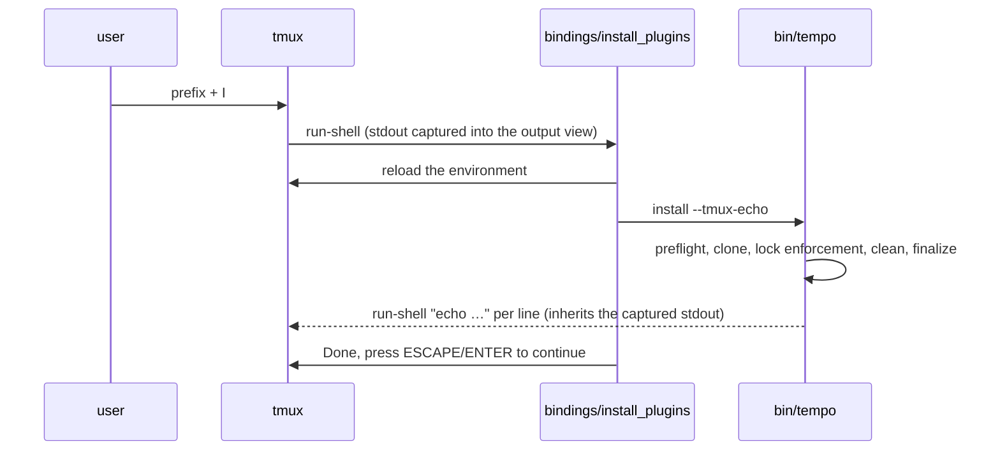

# How tempo works

A walkthrough of the implementation. The tpm compatibility contract this code
is written against and the product decisions behind it (cited below as
D<n>) live in the development monorepo this repository is split from; this
document explains how the code here realizes them. Each concept is named
once, in bold, the first time it appears, and that name is the one the code,
the output and the README use.

## One idea: compile the plugin list once, run the result every time

tpm re-parses your config with bash and awk on every tmux start. tempo does
that parse once, in Ruby, and writes a short shell script; tmux runs the
script. That is **static generation** (D2), and it splits tempo into two
planes:

- the **hot path**: POSIX sh, run by tmux on every server start. It never
  runs Ruby, never touches the network, and always exits 0.
- the **management plane**: Ruby, stdlib only. It runs only when you invoke a
  verb (`install`, `update`, `clean`, …), or from the hot path when the
  generated script is stale.

```text
tempo/
├── tpm                      # entry script: tmux version gate, publish the plugin path, bindings, hand off
├── tempo                    # one-line alias that execs tpm
├── scripts/
│   ├── source_plugins.sh    # the hot-path decision
│   └── helpers.sh           # freshness check, ruby gate, stat dialect probe
├── bindings/                # prefix+I / U / M-u: reload env, call bin/tempo --tmux-echo
├── bin/
│   ├── tempo                # sh launcher: ruby gate, then exec lib/tempo/main.rb
│   └── {install,update,clean}_plugins   # compat bins at the paths the ecosystem hardcodes
└── lib/tempo/
    ├── cli.rb               # dispatch; the one place a refusal is printed
    ├── commands.rb          # the verbs, plus preflight and finalize
    ├── env.rb               # Env: plugin path, candidate config files, specs; raises ObserverError
    ├── scraper.rb           # the scan: declarations, sourced files, fingerprint entries
    ├── spec.rb              # Spec: url, branch, plugin name, canonical line
    ├── tmux.rb              # Tmux.option (nil = could not ask), display_echo
    ├── git.rb               # clone, pull, branch-keeping checkout, fetch, commit_present?, preflight!
    ├── lockfile.rb          # read (Unparseable), write (carry-over / re-derive / refresh set)
    ├── generator.rb         # artifact and fingerprint
    ├── config_edit.rb       # add / remove: the only code that writes the primary config
    ├── init.rb              # drop-in mode / fresh mode, plan-then-confirm
    ├── doctor.rb            # one line per fact
    └── ui.rb                # ok / err / warn; exit code is 0 iff no err
```

## The hot path (every tmux start)

Your config's `run '~/.tmux/plugins/tpm/tpm'` line executes the
argument-less [`tpm`](tpm) **entry script** (`tempo` is a one-line alias
that execs it). It does four cheap things: the **tmux version gate**
(tmux ≥ 1.9, a real numeric comparison with the same outcome as the
original's digit-concat hack), publish `TMUX_PLUGIN_MANAGER_PATH` as a tmux
global environment variable only if unset, install the three **bindings**
(`prefix+I` / `prefix+U` / `prefix+M-u`, each overridable via `@tpm-install`
/ `@tpm-update` / `@tpm-clean`), then hand off to
[`scripts/source_plugins.sh`](scripts/source_plugins.sh), which is the
decision:

```text
on(tmux start)
  freshness check                      # pure sh: compare the fingerprint against live files
  if artifact fresh
    run artifact                       # zero Ruby, zero network: the steady state
  else if artifact stale and ruby gate passes
    generate                           # ~100 ms Ruby, still no network
    run artifact
  else if artifact stale and no Ruby
    run the stale artifact             # a previously working set beats nothing (D1 mitigation)
  else                                 # missing, no Ruby
    print one gate message on stderr, load nothing
  exit 0                               # always: a broken plugin set must never break config loading
```

Two files in the **data dir** (`$XDG_DATA_HOME/tempo`, default
`~/.local/share/tempo/`) make this work, and they are the only two it holds:

- the **artifact**, `load.sh` (written by
  [`lib/tempo/generator.rb`](lib/tempo/generator.rb)): a straight-line sh
  script with one `run_plugin_dir '<plugin path>/<name>/'` call per declared
  plugin, then `exit 0`. The `run_plugin_dir` function inside it encodes the
  contract's execution model: glob top-level `*.tmux` files, byte-sort them
  with `LC_ALL=C`, run each as an executable with output discarded, `|| :`
  so one broken plugin never stops the rest, plus the divergence-4 stderr
  warning for a non-executable file. The artifact bakes plugin _dirs_ and
  globs at run time, so a plugin's files changing (a hand-run `git pull`,
  say) never makes it stale. Only the plugin set does.
- the **fingerprint**: a line-oriented record of everything that fed the
  last regeneration. A header, the resolved plugin path, the live
  `@tpm_plugins` value, then one **fingerprint entry** per path the scan
  consulted: `f <mtime> <size> <path>` for a file that existed and
  `m <path>` for one that did not, so creating it later invalidates too.

The **freshness check** (`artifact_fresh` in
[`scripts/helpers.sh`](scripts/helpers.sh)) re-reads the fingerprint and
reports stale on _any_ mismatch and on any line it does not recognize. The
bias is "when in doubt, regenerate": regeneration is cheap, a wrong plugin
set is not. Its `_stat_mtime_size` helper probes both the GNU and the BSD
`stat` dialect and accepts only output shaped like two integers, because GNU
`stat -f` _succeeds_ in filesystem mode with garbage output, which silently
killed the hot path in an earlier iteration.

Compatibility is a property of the artifact, not of the generator: the
tpm compatibility suite cannot tell the architecture changed, because the
run line sits in the same place in the user's config and the artifact
re-executes every plugin on every reload.

## Observation: how tempo learns what you declared

Plain terms: tempo asks tmux for the old-style list, then reads your config
files for `@plugin` lines. Together that is the **observation**; the code
that performs it is the **observer**.

```text
Env#specs
  Tmux.option("@tpm_plugins")          → the legacy list      (nil = could not ask → ObserverError)
  Scraper#scan
    candidate config files             # every path tmux itself consults, not tpm's either/or rule
      declarations                     → Spec (url, branch, plugin name)
      sourced files, recursively       # source / source-file, globs expanded
      fingerprint entries              # every path touched, missing ones included
  → specs                              # ordered, legacy first, duplicates kept, like the original
  → the declared set                   # deduplicated plugin names
```

- **`Env`** ([`lib/tempo/env.rb`](lib/tempo/env.rb)) resolves all machine
  state, memoized. The **plugin path** is `TMUX_PLUGIN_MANAGER_PATH` from
  the tmux global environment, `~` expanded and a trailing slash forced,
  falling back to the XDG-aware default when unset (divergence 2, the fix
  that makes the documented auto-install snippet work on a fresh machine).
  The **candidate config files** are the full set tmux loads, a strict
  superset of tpm's rule. The **primary config** is the XDG conf if it
  exists, else `~/.tmux.conf`: it anchors the lockfile and is the only file
  tempo ever writes. Every value is constructor-overridable, so tests never
  need a tmux server.
- **`Scraper`** ([`lib/tempo/scraper.rb`](lib/tempo/scraper.rb)) performs
  the **scan**. Its **declaration** regex is no narrower than the original
  awk matcher (it accepts a tab where the original needed a space, a
  licensed drop) and deliberately has _no_ word boundary after `@plugin`,
  because the original matches `@plugins` too and accepting less than the
  original is the only real breakage. It follows **sourced files** recursively (a
  superset of tpm's one level) and records a fingerprint entry for every
  path it touches, including the parent dir of any sourced glob, since a
  glob can gain matches without any scanned file changing.
- **`Spec`** ([`lib/tempo/spec.rb`](lib/tempo/spec.rb)) is a parsed
  declaration: `url` (before `#`), `branch` (after it), and the **plugin
  name**, the riskiest line in the project: strip `#branch` first, then
  basename minus one trailing `.git`. Getting this wrong makes every
  existing installation "disappear." The **GitHub shorthand** `owner/repo`
  is expanded to `https://git::@github.com/owner/repo` only after the
  verbatim url fails to clone. `Spec.plugin_line` is the **canonical line**
  `set -g @plugin '<spec>'`, the one serialization `add` writes.

The rule that matters most (D34): a failed observation raises
**`ObserverError`** (tmux will not answer, or a config file exists and cannot
be read). It never returns an empty set, because "nothing declared" and
"could not ask" must stay distinguishable: the first is a user who declared
nothing, the second would otherwise let a mutating verb clean every plugin
and erase every pin over a broken tmux. The error is rescued as a
**refusal** in one place, `CLI.run`:

```text
tempo: <cause>
tempo: nothing was changed
exit 1
```

`status` is the exception, deliberately: it is a report, not a check, so it
prints the failure as one more fact and exits 0. `doctor` prints it and
exits 1, because its exit code already means "management operations cannot
work."

## Plugins on disk: nothing clever (D36)

Every plugin is a **plain clone** at its **plugin dir**, `<plugin
path>/<name>`, exactly where tpm puts it. A tree tpm, or a hand-run
`git clone`, left behind is already a tree tempo manages, with nothing to
migrate. A plugin is **installed** when its dir exists and `git remote`
succeeds in it. The git primitives
([`lib/tempo/git.rb`](lib/tempo/git.rb)) all run in place in the clone,
all with `GIT_TERMINAL_PROMPT=0` so nothing can block on a credential prompt
(a hang here wedges tmux's `run-shell`):

| primitive                     | what it does                                                                                                                                                               |
| ----------------------------- | -------------------------------------------------------------------------------------------------------------------------------------------------------------------------- |
| **clone**                     | `git clone --single-branch [-b branch] --recursive`, full history like the original; the verbatim url first, then the GitHub shorthand                                     |
| **pull**                      | `git pull` then `git submodule update --init --recursive`; its combined output is the `    \|`-indented report the compat contract pins                                    |
| **checkout (branch-keeping)** | `git checkout -B <current-branch> <sha>` when HEAD is on a branch, a plain checkout otherwise. Refuses, rather than discards, a conflicting local edit: not `reset --hard` |
| **commit present**            | read-only `git cat-file -e <sha>^{commit}`: the frozen check's way of asking without mutating                                                                              |

The branch-keeping checkout is the primitive under lock enforcement, and
the reason it keeps the branch is that `update` is a plain `git pull`. A
detached HEAD makes that pull fail with "not currently on a branch," turning
every enforced plugin into one `update` can no longer move. A clone that is
already detached stays detached.

Untracked files a plugin writes into its own tree survive `install` and
`update` but not a fresh clone elsewhere; the README's recipe for that case
is a **fork branch** declared with `#branch` and merged, never rebased, from
upstream.

## The lockfile: an input, never a snapshot

`tempo.lock` is JSON beside the realpath of the primary config (so a
symlinked dotfiles conf gets the lock inside the dotfiles repo), mapping
plugin name to a **lock entry** `{url, branch, commit}`. `branch` comes from
the declaration and is `null` when the declaration has no `#branch`.
`commit` is the **pin**. The key design choice (D33) is the write rule in
[`lib/tempo/lockfile.rb`](lib/tempo/lockfile.rb):

```text
Lockfile.write(env, refresh)
  read the existing lock first                    # missing reads as {}; unparseable was already refused
  for each declared plugin
    if name in refresh                → re-derive from disk      # update's successes only
    else if the lock has an entry     → carry-over, verbatim
    else                              → re-derive                # never seen: freshly cloned, or hand-cloned
  drop entries for plugins no longer declared     # the same run just cleaned them
```

- **carry-over**: an existing entry for a still-declared plugin is kept byte
  for byte.
- **re-derive**: an entry is read off disk (`git remote get-url` plus
  HEAD). This happens only for a declared plugin the lock has never seen,
  or for a name in the **refresh set**: the plugins `update` actually
  moved. `install` and `clean` pass an empty refresh set.

Consequence, in one sentence: **a pin moves only through `update`, or when
you edit or revert the lock yourself.** A failed clone, a failed lock
enforcement, or a plugin the observer could not see all leave the committed
pin exactly where it was. There is still no remembered install-time state;
the first time a plugin is seen its entry comes from disk. It is just never
re-derived while the lock already has an answer.

**Undo** for a bad update is not a tempo command: put the previous
`tempo.lock` back from your dotfiles history and run `install`, which puts
every plugin on the commits it names. That only exists if the lock is under
version control, which is why `doctor`'s `lockfile:` line says when it is
not **tracked** by git.

When the lock exists but is not valid JSON of the right shape,
`Lockfile.read` raises **`Unparseable`**, and every mutating verb refuses
before touching disk (D35). A merge-conflicted lock across two machines is the realistic
case; the old behavior overwrote it at exit 0.

## The verbs

A **mutating verb** is one that changes disk: `install`, `update`, `clean`,
`add`, `init`, `remove`. The first four begin in **preflight** (D35), and
`install`, `update` and `clean` end in **finalize**:

```text
Commands.preflight                     # before any write; any failure is a refusal, nothing has moved
  Git.preflight!                       # git --version must run; carries git's own first line (Git::Unavailable)
  Lockfile.read                        # the lock must parse (Unparseable)
  env.specs                            # the declared set must be observable (ObserverError)

Commands.finalize(env, refresh)
  Lockfile.write(env, refresh)
  generate                             # rebuild artifact and fingerprint
```

The git preflight runs first because it is cheapest and, when it fires, it
is the cause: with git unable to run, the old `install` printed
`download fail` for every plugin on a working network.

**`install`** is the reconciling verb (D32): install what is missing, put
every installed plugin on its locked commit, remove what is no longer
declared. tpm's install could only do the first, having no lock to enforce.

```text
Commands.install
  preflight
  (--frozen?) → frozen_enforce         # verify, enforce offline, clean, generate; never writes the lock
  prepare_path                         # mkdir the plugin path
  if nothing declared
    zero-plugin guidance, return       # no clean, no lock write
  install_missing                      # clone each declared plugin that is not installed
  restore_locked                       # lock enforcement
  clean_undeclared                     # own-install guard: never the dir literally named `tpm`, never the running code's realpath
  finalize                             # refresh set empty
```

**Lock enforcement** (`Commands.restore_locked`) moves each installed,
declared plugin to its pin with the branch-keeping checkout, and when the
commit is not local retries once after a `git fetch`: the **fetch retry**,
the only network touch enforcement makes, dropped under `--frozen`. Success
prints `"<name>" restored to <sha12>`; a failure (the conflicting-edit case,
or a commit that upstream no longer has) prints a `restore fail` line that
names the remedy, `tempo update <name>`, because that is the one verb that
moves the pin. The identifier and the two strings predate the vocabulary and
are kept; in prose the step is lock enforcement.

The zero-declared guard is load-bearing. Cleaning sits on a keystroke
(`prefix+I`), and an empty declared set nearly always means tmux read a
different config than the one you edited; without the guard, one typo in a
config path deletes every installed plugin. Explicit `tempo clean` keeps
tpm's meaning and removes everything, because tpm's clean does and the
compat suite pins it.

**`install --frozen`** is the offline variant, for a host that already has
its clones and must never download; it is not the everyday path, and the CI
check is plain `install` followed by `git diff --exit-code tempo.lock`
(README "Checking the lock in CI"). Under the flag the **frozen check**
(`Commands.frozen_violations`) lists one **violation** per declared plugin
that is not installed, not in the lockfile, or whose locked commit is not
present locally; then enforcement runs offline, undeclared dirs are
cleaned, the artifact is regenerated, and the lock is never written. Exit 1
on any violation, and also when nothing is declared: a check that passes
having verified nothing is worse than one that fails.

Where each verb sits:

| verb               | preflight | finalize      | notes                                                                                                                                        |
| ------------------ | --------- | ------------- | -------------------------------------------------------------------------------------------------------------------------------------------- |
| `install`          | yes       | yes           | refresh set empty                                                                                                                            |
| `update`           | yes       | yes           | parallel pulls with per-plugin atomic output; refresh set = the names that actually pulled; `"<name>" not installed!` exits 1 (divergence 1) |
| `clean`            | yes       | yes           | exact-name membership; with nothing declared it removes everything, unlike `install`                                                         |
| `add`              | yes       | via `install` | one config backup, append the canonical line above the manager's run line, then `install` on a fresh observation                             |
| `remove`           | no        | no            | config text only; never asks tmux, never uninstalls                                                                                          |
| `init`             | no        | no            | its own run-line parser; drop-in mode or fresh mode, plan-then-confirm                                                                       |
| `generate`         | no        | —             | writes only the data dir                                                                                                                     |
| `status`, `doctor` | no        | —             | reports; `status` always exits 0, `doctor` exit 1 means "cannot manage"                                                                      |

**`ConfigEdit`** ([`lib/tempo/config_edit.rb`](lib/tempo/config_edit.rb))
is the only code that writes the user's tmux config (D22), behind `add` and
`remove`. `remove` deletes a declaration only when it can parse the whole
line, and otherwise refuses with the exact `file:line` and "remove it by
hand": a declaration inside a `%if` block, in a sourced file, or via the
legacy `@tpm_plugins` list is always a refusal. A refusal is all-or-nothing
per invocation, and writes no **config backup** either, so a refused run
leaves the directory byte-identical. This is the counterweight to the ban on
a separate manifest: the config _is_ the plugin list, so editing it must be
conservative enough never to mangle a hand-tuned file. Writes go through a
timestamped `.bak-` copy and through a symlinked conf rather than over it,
so a dotfiles symlink stays a symlink.

**`UI`** ([`lib/tempo/ui.rb`](lib/tempo/ui.rb)) has three outputs: `ok` to
stdout, `err` to stderr with the failed flag set, `warn` to stderr without
it. The exit code is 0 iff nothing called `err`, which is divergence 1: the
original lost failures in backgrounded subshells and always exited 0.

## The interactive path (the subtle part)

tmux shows a `run-shell` job's captured stdout in its output view, and
nested `tmux run-shell "echo …"` clients _inherit_ that stdout. That is
**tmux-echo mode**: with `--tmux-echo`, every `UI` line is also sent through
a nested `run-shell echo`, so it lands in the binding's view.



The bindings are choreographed around one rule: **never capture stdout in
the banner/update chain**. `Tmux.display_echo` uses `system`, not
`capture2e`, and [`bindings/update_plugins`](bindings/update_plugins)
leaves stdout unredirected while install and clean redirect it, matching
the original's exact UX on tmux ≥ 3. The first implementation captured
somewhere in that chain and all interactive output silently vanished.

The `prefix+U` flow: reload the environment, echo the installed-plugins
banner (divergence 3: branch-selected plugins now appear, because names are
branch-stripped before the installed check), `command-prompt -p 'plugin
update:'`; empty input arrives as zero args and cancels silently, anything
else runs the same word-splitting path as the CLI, then reloads and prints
the `Done, press ESCAPE/ENTER to continue` message keyed off `mode-keys`.

## Compatibility posture, in one paragraph

tempo is a drop-in: clone it to `~/.tmux/plugins/tpm`, change nothing in
your dotfiles, and the same bins and the same output strings are there. It
departs from tpm in five **intentional divergences**, each a known defect
fixed on purpose: real exit codes from update (1); the default plugin path
when `TMUX_PLUGIN_MANAGER_PATH` is unset (2); `#branch` plugins listed in
the `prefix+U` banner (3); a stderr warning for a non-executable `*.tmux`
file (4); and the reconciling `install` (5, D32). The contract licenses eight
**licensed drops**, accidental tpm behaviors with no plausible dependents,
and tempo takes them:
clean's substring match, locale-collated glob order, parser rejection
trivia, one-level source scanning, the `=`-truncating path cut and the
double slash in `$0`, the leaked exit status of the last plugin, the
digit-concat version comparator, and three dead comments and parameters.
Anything not on that list is kept.

## The gates

```sh
ruby -Ilib -Itest test/run_all.rb   # tempo's own unit suite, ships here
sh test/flows/run_flows.sh          # end-to-end flows against a real tmux server, ships here
```

The third gate, the held-out tpm compatibility suite (30 tests, two carrying
divergence notes: the update exit code and the reconciling `install`), runs
against this tree from the development monorepo, where the suite and the
vendored original live. It is deliberately not vendored here: a parity suite
you can edit alongside the implementation has stopped being a held-out test.
Every harness builds its own sandbox (a throwaway `$HOME`, a private
`TMUX_TMPDIR`, local fixture repos), so none of them can reach your real
plugins. `bin/tempo` itself is not sandboxed, by design.

## Known trade-offs

- **Per-user artifact, not per-plugin-path**: two configs alternating
  `TMUX_PLUGIN_MANAGER_PATH` under one `$HOME` regenerate on each switch.
  Correct, just uncached.
- **Fingerprint granularity is mtime-seconds plus size**: a same-second,
  same-size edit is invisible; `install`, `update` or `clean` (`add` runs
  through `install`), or `bin/tempo generate`, forces regeneration.
- **Stale artifact plus no Ruby runs the stale set silently**, a deliberate
  D1 mitigation.
- **No cross-config dedup, no tool-level undo** (D36): two plugin paths
  holding the same plugin hold two full clones, and tempo keeps no history
  of its own. Undo is the committed `tempo.lock` plus `install`, which needs
  the lock under version control and needs the network for any commit the
  clone no longer has.
- **A config tmux read but tempo did not scan** (`tmux -f other.conf`)
  observes as nothing declared: correct from tempo's side, wrong from yours.
  `doctor`'s `configs:` line and the zero-plugin guidance exist for this.
